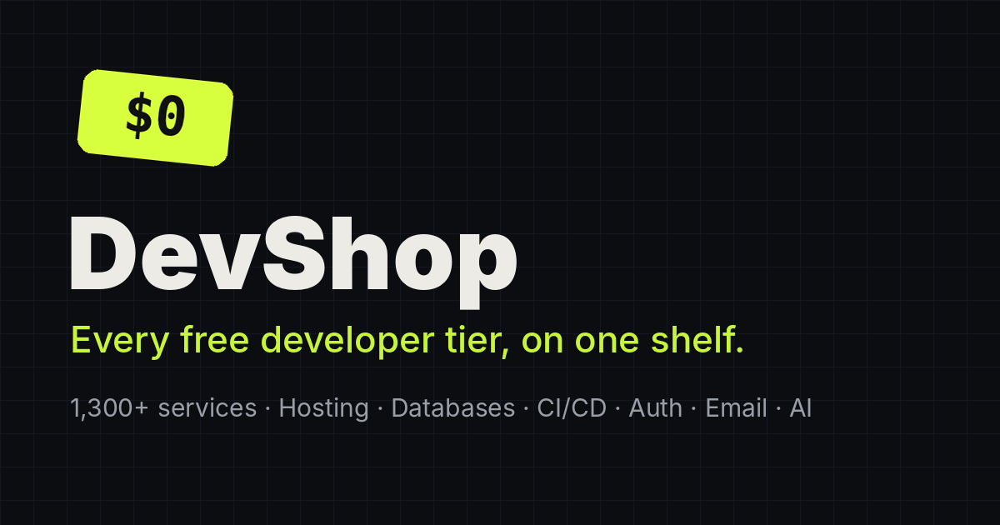

<div align="center">


# DevShop

### Every free developer tier, on one shelf.

**A fast, searchable directory of 1,300+ SaaS, PaaS, IaaS and API services with genuinely free tiers for developers.**

[**🌐 Live site**](https://jrnoorbaloch.github.io/DevShop/) ·
[**🔌 JSON API**](https://jrnoorbaloch.github.io/DevShop/api/services.json) ·
[**🗺️ Sitemap**](https://jrnoorbaloch.github.io/DevShop/sitemap.xml)

[](https://github.com/jrnoorbaloch/DevShop/actions/workflows/deploy.yml)
[](https://github.com/jrnoorbaloch/DevShop/actions/workflows/sync-upstream.yml)


[](LICENSE)



</div>

---

## What is DevShop?

DevShop turns the huge community list of free developer services into a real product: a web app where you can **search, filter, compare and save** free tiers for hosting, databases, CI/CD, authentication, email, monitoring, generative AI APIs, CDN, DNS, storage and more. Each listed service is a real *free tier*, not a short trial.

The original list lives in one long markdown file. DevShop parses it into structured data and adds a fast search UI, a page for every category and every service, a public JSON API, offline support, and automatic weekly syncing.

## ✨ Features

| | Feature | Details |
|---|---|---|
| 🔎 | **Instant search** | Ranked search across 1,300+ services (name, domain, category, description, tags). Press <kbd>/</kbd> from anywhere. |
| 🏷️ | **Smart tags** | Auto-detected filters: *No credit card*, *Open source*, *Unlimited*, *Forever free*, *AI / ML*, *API*, *EU / GDPR*, *Students*, *Teams*, *Self-host option*. |
| 🗂️ | **56 categories** | Filter in place or open a dedicated, pre-rendered category page. |
| ⭐ | **Saved shelf** | Bookmark services (stored locally, no account), show saved only, and **export them as Markdown**. |
| 🔗 | **Shareable views** | Search, category, tags and sort live in the URL. "Copy link to this view" in one click. |
| 🎲 | **Surprise me** | Jump to a random free tier, within your current filters. |
| ☰ | **Grid / compact view** | A dense list view for scanning quickly. |
| 🌗 | **Dark & light themes** | Follows your system theme, with a manual toggle. |
| 📱 | **PWA / offline** | Installable, with a service worker that caches the catalogue. |
| 🔌 | **Public JSON API** | `/api/services.json` and `/api/categories.json`. Static, no key, CORS-friendly via GitHub Pages. |
| 🔄 | **Auto-sync** | A weekly GitHub Action pulls the latest upstream list, validates it, and redeploys. |
| ⚡ | **Zero dependencies** | Python standard library build plus vanilla JS and CSS. No framework, no bundler, no `node_modules`. |

## 🚀 SEO built in

DevShop is built to rank for searches like *"free postgres hosting"*, *"X free tier"* or *"free email API"*:

- **1,370+ pre-rendered static pages**: one per service (`/service/<name>/`) and one per category (`/category/<name>/`), each with its own title and meta description.
- **Structured data (JSON-LD):** `WebSite` + `SearchAction` (sitelinks search box), `Organization`, `FAQPage`, `CollectionPage` + `ItemList`, `SoftwareApplication` with a `$0` `Offer`, and `BreadcrumbList` on every page.
- **Open Graph and Twitter cards** with a 1200×630 social image.
- Canonical URLs, an auto-generated `sitemap.xml` (with `lastmod`), `robots.txt`, and an `opensearch.xml` so browsers can add DevShop as a search engine.
- Internal linking between related services ("Alternatives to X") and neighbouring categories.
- Semantic HTML, a skip link, `aria-live` result counts, reduced-motion support, and lazy-loaded favicons for good Core Web Vitals.

## 🛠️ Run locally

```bash
git clone https://github.com/jrnoorbaloch/DevShop.git
cd DevShop
SITE_URL=http://localhost:8000 python3 scripts/build.py
cd dist && python3 -m http.server 8000
# open http://localhost:8000
```

All you need is Python 3.9+. There is nothing to install.

## 📁 Project structure

```
DevShop/
├── data/source/free-for-dev.md   # upstream catalogue (synced weekly)
├── scripts/build.py              # parser + static site generator (stdlib only)
├── static/
│   ├── assets/                   # style.css, app.js, icons, OG image
│   └── sw.js                     # service worker template
└── .github/workflows/
    ├── deploy.yml                # build → GitHub Pages on every push
    └── sync-upstream.yml         # weekly upstream sync + redeploy
```

## 🔌 API

```bash
curl https://jrnoorbaloch.github.io/DevShop/api/services.json
```

```jsonc
{
  "generated": "2026-11-16",
  "count": 1311,
  "services": [
    {
      "id": 1,
      "slug": "google-cloud-platform",
      "name": "Google Cloud Platform",
      "url": "https://cloud.google.com",
      "domain": "cloud.google.com",
      "category": "major-cloud-providers",
      "categoryName": "Major Cloud Providers",
      "description": "Free tier includes App Engine, Cloud Firestore, …",
      "details": ["App Engine - 28 frontend instance hours per day, …"],
      "tags": ["API"]
    }
  ]
}
```

## 🚢 Deploy your own

1. Fork the repo.
2. **Settings → Pages → Source: GitHub Actions**.
3. Push to `main`. The site deploys to `https://<you>.github.io/DevShop/`. The build reads the Pages URL automatically, so canonical links and the sitemap stay correct.

## 🤝 Contributing

- **UI / features / SEO:** pull requests are welcome in this repo.
- **Adding or fixing a service listing:** the data comes from [ripienaar/free-for-dev](https://github.com/ripienaar/free-for-dev). Please follow *their* contribution guidelines and PR template. DevShop picks up the changes on its next weekly sync.

## 🙏 Credits

The service catalogue is the work of the 1,600+ contributors to **[free-for-dev](https://github.com/ripienaar/free-for-dev)** by R.I. Pienaar. DevShop is an independent front end built on top of it. Free tiers change often, so always check the provider's pricing page.

## 📄 License

DevShop's code is released under the [MIT License](LICENSE). The catalogue data remains credited to the free-for-dev contributors.

---

<sub>**Keywords:** free tier, free developer tools, free hosting, free database, free postgres, free CI/CD, free API, free SaaS for developers, free cloud credits, free email API, free auth, free monitoring, free AI API, devops tools, free-for-dev, awesome list, developer resources.</sub>
